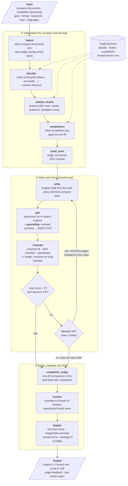

# AI Content Generator

A multi-agent pipeline that writes marketing content (blog posts, landing pages,
social posts, emails, ad copy, mottos) from a company's own material. It checks
every factual claim against that material, scores the result with several judges,
rewrites once if the score is too low, and can translate the final text to Finnish.

Live at `hasanai.net/ai-content-generator/` (sign-in required, with a daily job limit per user).

---

## How it works

The pipeline is a [LangGraph](https://github.com/langchain-ai/langgraph) state graph
(`pipeline/pipeline.py`). Each node is one agent; they share a single `PipelineState`.

The graph runs in three stages: first it **understands** the company and the task,
then it **writes and checks** in a loop, and finally it **judges, translates and
finishes** the result.



**Reading the diagram**

- **Stage ① runs once per job.** Its three analysis steps (dashed lines) are cached, so
  generating a second format from the same material skips them.
- **Stage ② is the quality loop.** Every draft is fact-checked *before* it is scored, so an
  invented statistic can never be the reason a draft passes. If the draft scores under 70
  (or a long article has the wrong length or too few sections), the writer gets the
  judges' written feedback and tries again. At most two drafts are written, which keeps
  the number of model calls (and the free-tier cost) predictable. After the second draft
  the pipeline moves on even if the draft did not pass, and the score shows that.
- **Stage ③ runs once on the final draft.** The competitor judge is outside the loop
  because it is the most expensive comparison and rarely changes after a rewrite; its
  score is part of the final average (see *The score* below).

| # | Node | Agent file | What it does |
|---|------|------------|--------------|
| 1 | `ingest` | `agents/ingestion.py` | Splits the uploaded company documents into chunks (`KnowledgeChunk`) for retrieval. |
| 2 | `classify` | `agents/content_classifier.py` | Reads the goal and decides the intent (inform, persuade, …) and section structure. |
| 3 | `analyze_brand` | `agents/brand_analyzer.py` | Builds a brand profile (tone, values, audience, forbidden words) from the company material (RAG). |
| 4 | `competitors` | `agents/competitor_analyzer.py` | Compares against competitor material and lists the gaps our content should fill. |
| 5 | `build_brief` | `agents/content_writer.py` | Turns goal + brand + gaps into a brief (angle, key points, SEO controls). |
| 6 | `write` | `agents/content_writer.py` | Writes the English draft, retrieving relevant company chunks (RAG). On a retry it gets the judges' feedback. |
| 7 | `geo` | `agents/geo_optimizer.py`, `agents/grounding.py` | Restructures long formats for AI search engines (GEO), then removes unsupported figures (see *Grounding*). |
| 8 | `evaluate` | `agents/evaluator.py` | Runs the in-loop judges and decides: pass, or rewrite. |
| 9 | `competitor_judge` | `agents/evaluator.py` | Runs once on the final draft: how it compares with competitors. |
| 10 | `localize` | `agents/localizer.py` | Translates to the chosen target languages (English or English + Finnish), keeping the brand voice. |
| 11 | `finalize` | `pipeline.py` | Final fact check, image/video prompt suggestions, and the final score. |

Expensive analysis steps (classification, brand profile, competitor gaps) are cached in
`AnalysisCache`, so generating several formats from the same material does not repeat them.

**Models.** `agents/lc_client.py` calls **Gemini** (`GEMINI_MODEL`, default
`gemini-2.5-flash`) first and falls back to **Groq** through LangChain `ChatGroq`
(`GROQ_MODEL`; `GROQ_MODEL_LARGE` for translation). All three can be overridden by
environment variables. Prompts are capped at 12,000 characters to stay inside the free tiers.

**Running.** `views.py` creates a `GenerationJob`; `worker.py` runs the pipeline in a
background thread and reports progress (the waiting page shows the current step). The
result — the English text (and Finnish, if chosen), the evaluation and the fact-check
report — is stored on the job.

---

## Grounding: no invented facts

LLMs like to make content "stronger" with numbers they invent. Two layers stop that
(`agents/grounding.py`):

1. **Prompt rules** (`GROUNDING_RULES`): use only facts from the company material, the
   goal and the keywords; never invent statistics, customers, awards, studies or quotes;
   write the placeholder `[ADD STAT]` where a figure would help but none exists.
2. **Deterministic check** (`check_and_clean`): a regex pass finds numeric claims
   (percentages, `3x`, money, "500 customers", "10 years", ratings, "1 in 3",
   "since 2015", …). Any claim whose number does **not** appear in the sources is
   replaced with `[ADD STAT]`. Attributions ("studies show", "according to …") and quotes
   that are not in the sources are flagged for human review.

The check runs **before** the judges see the text, so a made-up number can never be the
reason content passes. It runs again on the Finnish translation and in `finalize`.

---

## The score

Every generated piece gets an **overall score from 0 to 100**, shown on the result page
together with each judge's score and feedback. It is the average of four judges: three
that are LLM-as-a-judge and one deterministic checklist.

### The four judges (`agents/evaluator.py`)

| Judge | Type | Measures | How the number is produced |
|-------|------|----------|----------------------------|
| **Customer fit** | LLM judge | Does it serve the target audience? Real pain points, right level, answers the questions they would ask, clear value proposition, call to action. | The model returns `score` 0–100 plus details (pain points addressed, clarity, value proposition) and feedback. |
| **Naturalness** | LLM judge + rule | Does it read like a skilled copywriter, not like AI text? | The model scores 0–100 on a rubric (90–100 skilled copywriter … 0–29 robotic). Then **3 points are subtracted for each AI cliché** found in the text (`delve`, `leverage`, `seamless`, `game-changer`, `in conclusion`, … — the `AI_CLICHES` list). |
| **GEO compliance** | Deterministic checklist (no LLM) | Is it structured so AI search engines (ChatGPT, Perplexity, Google AI answers) can quote it? | Score = `100 × checks passed / checks that apply`. |
| **Competitor edge** | LLM judge | Is it more specific than the competitors' content, does it fill their gaps, does it have its own angle? | The model scores 0–100 against up to three competitor documents and the gap list. **If no competitor material was given, it is a fixed 75** (neutral). |

Customer fit and naturalness are scored in **one** model call (`judge_quality`): they read
the same text, and two calls doubled the cost of every attempt.

**GEO checklist** (`judge_geo`):

| Check | Passes when |
|-------|-------------|
| Direct answer | A sentence plainly says what it is / who it helps ("is defined as", "refers to", "helps", …). |
| Concrete facts | The text contains a figure (already verified by grounding) or an `[ADD STAT]` placeholder. |
| Question headings | At least one heading is phrased as a question (What / How / Why …). |
| Short paragraphs | Average paragraph length is at most ~90 words. |
| No unsourced claims | No "studies show" / "according to" without a source. |

Only the checks that make sense for the format count: a **motto** is judged only on
"no unsourced claims"; **ad copy** on short paragraphs + no unsourced claims; **social
posts and emails** on direct answer + short paragraphs + no unsourced claims; **blog posts
and landing pages** on all five. (A tagline must not be pushed to contain headings or figures.)

### How the judges are combined

**Inside the rewrite loop** (`evaluate_loop`, after each draft):

```
loop score = round( (customer + GEO + naturalness) / 3 )
passed     = loop score >= 70  AND  no structure issues
```

*Structure issues* apply only to blog posts and landing pages (`judge_structure`):
too short / too long for the requested word range (25 % overrun allowed), fewer H2
sections than requested, or a missing FAQ section when one was asked for.

If the draft does not pass, the writer gets the judges' written feedback (customer
feedback, the missing GEO signals, naturalness feedback, structure issues) and rewrites.
`MAX_RETRIES = 2` in `pipeline/config.py`, i.e. the first draft plus one rewrite. This keeps
each job to a predictable number of model calls on the free tiers.

**Final score** (`finalize`, after the competitor judge):

```
overall score = round( (customer + GEO + competitor + naturalness) / 4 )
passed        = overall score >= 70
```

This is the number stored in `GenerationJob.overall_score` and shown in the UI
(green ≥ 75, amber 50–74, red < 50).

### Worked example

A landing page draft gets customer fit 82, naturalness 80 (the model said 86, but the text
used "seamless" and "leverage": 86 − 2 × 3 = 80), and GEO 80 (4 of 5 checks passed; no
question heading).

- Loop score = round((82 + 80 + 80) / 3) = 81 ≥ 70, and the structure is fine → passes,
  no rewrite.
- Competitor judge: 70.
- **Overall = round((82 + 80 + 70 + 80) / 4) = 78.**

### What the score is — and is not

- It is a **relative quality signal** used for two things: deciding automatically whether
  a draft needs a rewrite, and showing the user where the content is weak (each judge's
  feedback and the GEO checklist are more useful than the single number).
- Three of the four judges are **LLM-as-a-judge**. The same model family writes and
  judges, so scores tend to be optimistic (self-preference bias), and the same text can
  score a few points differently between runs. Mitigations here: rubric-anchored prompts,
  JSON output with sub-criteria, the deterministic GEO checklist and cliché penalty, and
  grounding that removes invented facts before scoring.
- It is **not calibrated against human ratings** and not a guarantee of business results.
  If a judge's reply misses a field, the code falls back to 70 (75 for the competitor
  judge without competitor data), which keeps the pipeline running but pulls the score
  toward the middle.
- Natural next steps: compare judge scores with human ratings on a small labelled set,
  use a different model as the judge than as the writer, and average a few judge runs.

---

## Files

```
content_generator/
├── models.py            Company/competitor profiles, documents, GenerationJob, KnowledgeChunk, AnalysisCache
├── views.py             Generate form, job status, result, history, edit/approve/rerun, CMS publish, Slack notice
├── worker.py            Background thread that runs jobs
├── pipeline/
│   ├── config.py        Models, MAX_RETRIES
│   ├── pipeline.py      LangGraph graph, nodes, final score
│   ├── pydantic_models.py  ContentPiece, BrandProfile, CompetitorGapMap, JudgeResult, EvaluationResult
│   └── agents/
│       ├── evaluator.py      The judges and the score
│       ├── grounding.py      Fact rules + deterministic claim check
│       ├── lc_client.py      Gemini → Groq (LangChain) + chunk retrieval
│       └── …                 One file per agent (see the table above)
```

Unused leftovers worth knowing about: `judge_customer` and `judge_naturalness` (replaced by
the combined `judge_quality`), `evaluate_brand_alignment` in `brand_analyzer.py`, and the
`*_THRESHOLD` constants in `config.py` are not called by the current pipeline.
